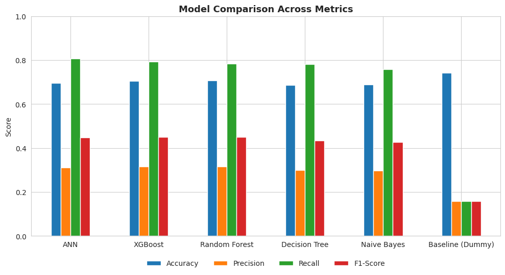
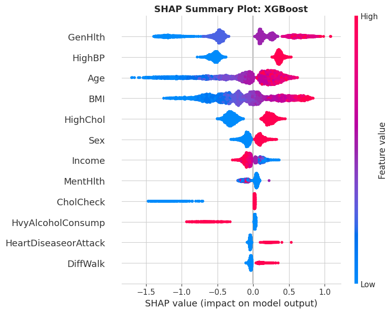
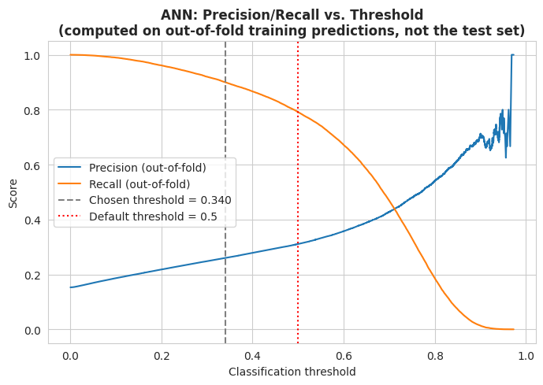

# Diabetes Risk Prediction with Machine Learning

Can answers from a routine health survey flag people who should get a diabetes blood test?
This project compares five machine learning models on 253,680 survey responses. It recommends
a tuned XGBoost model that catches **90.6% of diabetic cases** in unseen test data.

More than a quarter of US adults with diabetes are undiagnosed. A missed case means no
follow-up, while a false alarm costs one extra blood test. The project is therefore built
around **Recall**: the share of real diabetic cases the model catches.



## Results

| | Default threshold (0.5) | Tuned threshold (0.352) |
|---|---|---|
| Recall (diabetic cases caught) | 79.4% | **90.6%** |
| Precision (flagged people who are diabetic) | 31.5% | 26.2% |
| Diabetic cases missed (of 7,019 in the test set) | 1,447 | 661 |
| People flagged per true case | 3.2 | 3.8 |

Test set: 45,895 respondents, never used to make a modelling decision.

**Model choice.** The neural network had the highest Recall at the default threshold. Its lead
over XGBoost was not statistically significant, and it changed with the random seed. XGBoost was
chosen because it is reproducible, more stable across folds (Recall standard deviation 0.0067
against 0.0118), ranks people slightly better (ROC-AUC 0.815) and can be explained with SHAP.
Once both models are tuned to the same 90% Recall target, they perform almost identically.

## Approach

1. **Clean.** Removed 24,206 exact duplicate rows (9.5%) before splitting, so no test row was
   seen in training. 229,474 rows remain.
2. **Explore.** Pearson correlation and mutual information agree on the strongest signals:
   general health, high blood pressure, BMI, age and high cholesterol.
3. **Engineer.** Grouped BMI into WHO categories for interpretation (obese respondents are
   almost four times as likely to report diabetes as normal-weight ones), applied a log
   transformation to skewed features where it helped, and scaled inputs for the neural network.
   Every statistic used to make a decision was computed on the training set only.
4. **Handle imbalance (5.54 to 1).** Compared class weighting, SMOTE and random undersampling
   with cross-validation. SMOTE did worst and produced impossible values, such as 0.37 for a
   yes/no answer, so class weighting was used.
5. **Model.** Decision Tree, Random Forest, Gaussian Naive Bayes, XGBoost and a multilayer
   neural network (Keras), each tuned on Recall with cross-validation.
6. **Evaluate.** Stratified 80/20 split, 10-fold cross-validation, and Wilcoxon, corrected
   t-test and bootstrap comparisons.
7. **Tune the threshold.** Chose the decision threshold on out-of-fold training predictions
   (target: at least 90% Recall), then applied it once to the test set.
8. **Explain and check errors.** SHAP shows the model learned a BMI turning point of about 29,
   close to the WHO obesity cut-off of 30. Error analysis shows who the model still misses.



## Limitations

- **Uneven performance.** The model misses 51% of diabetic respondents aged 18 to 39, against 5%
  of those aged 60 and over. Missed cases look healthy in the survey: younger, leaner and with
  normal blood pressure. A negative result should not reassure these groups.
- **Recognition, not prediction.** The survey is a single point in time, so the model recognises
  current diabetes status. It does not predict who will develop diabetes.
- **Some signals may be consequences.** Poor general health and difficulty walking may result
  from diabetes rather than cause it. Whether a respondent had a cholesterol check reflects
  contact with doctors as well as biology.



## Run it

1. Download `diabetes_binary_health_indicators_BRFSS2015.csv` from the
   [Diabetes Health Indicators dataset on Kaggle](https://www.kaggle.com/datasets/alexteboul/diabetes-health-indicators-dataset)
   and place it next to the notebook. The data file is not stored in this repository.
2. Install the packages (tested with Python 3.12):
   ```
   pip install -r requirements.txt
   ```
3. Open `diabetes_risk_prediction.ipynb` in Jupyter or Google Colab and run all cells.
   A fixed random seed (42) is used throughout. Neural network results can still vary slightly
   between runs, as noted above.

## Repository

| File | Contents |
|---|---|
| `diabetes_risk_prediction.ipynb` | Full analysis, with outputs, from loading the data to error analysis |
| `requirements.txt` | Python packages and the versions tested |
| `figures/` | Charts used in this README, exported from the notebook |

## Data and credits

- Data: Teboul, A. (2021). *Diabetes Health Indicators Dataset*. Kaggle. A cleaned version of
  the CDC's 2015 Behavioral Risk Factor Surveillance System (BRFSS) survey.
- Built for a machine learning unit at Charles Darwin University (2026) by a team of three.
  I led the team and built the full pipeline.

**Will Nguyen**, Darwin NT · [LinkedIn](https://linkedin.com/in/ngocanh8585)
